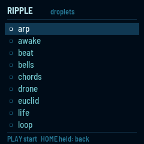
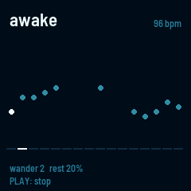
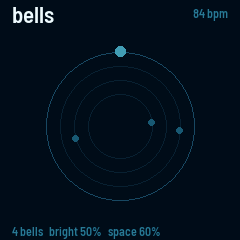
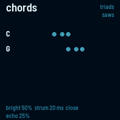
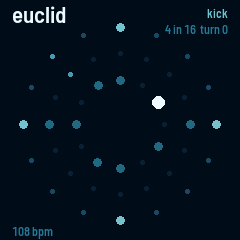
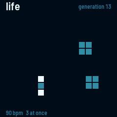
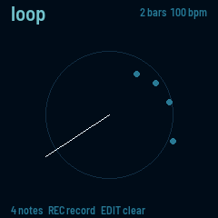
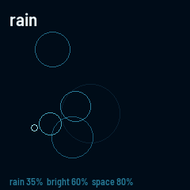
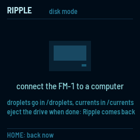
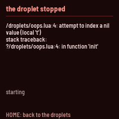

# Ripple

Ripple turns the M-VAVE FM-1 into an instrument you can reprogram without reflashing. It runs droplets: small
programs in Lua, each one a different instrument, from a drum machine to a generative ambient piece. The sounds
come from currents, written in Faust, Pd or C. Any droplet can load any currents and chain them as it likes, so the
same voices, drums and effects turn up in many instruments, and a new one can be a few lines of Lua. Twelve
droplets and six currents are built in, and you can add your own: in disk mode the FM-1 shows up on your computer
as a USB drive, and you copy files onto it.

The idea comes from monome's norns: small scripts over compiled sound engines.

---

## Contents

1. Install
2. The list
3. The built-in droplets
4. Disk mode
5. Saving
6. When a droplet stops
7. Writing your own
8. Limits

---

## 1. Install

In Chrome or Edge, connect the FM-1 by USB, open the installer and press Install. The browser asks once to allow
MIDI: allow it. Don't unplug the cable while it writes.

From a terminal, `python3 tools/fm1_install.py ripple-VERSION.fwsc` does the same.

The installer's last section puts M-VAVE's own firmware back.

---

## 2. The list

Ripple starts on the list of droplets. Built-in ones have an outlined mark, and droplets from your disk a filled
one. A droplet on your disk with the same name as a built-in one is used instead of it.

| Control | What it does |
| --- | --- |
| SELECT, OCT− · OCT+ | Move through the list. |
| PLAY or SEL | Start the droplet. |
| HOME, held a second | Leave a droplet and come back to the list, from anywhere. |

The last two entries aren't droplets. **Disk mode** shows the disk to a computer. **Empty the disk** erases
everything on it and leaves its folders: press PLAY twice. The built-in droplets aren't on the disk, so they stay.

Ripple remembers the droplet you started last and starts the list there.

---

## 3. The built-in droplets

While a droplet runs, the keys, knobs and buttons are its own, except HOME held a second. MASTER is the volume.

| Droplet | What it is |
| --- | --- |
| arp | Hold keys and they play one after another. |
| awake | A melody that wanders a scale on its own. |
| beat | A 16-step drum machine on the white keys. |
| bells | FM bells on loops of different lengths, drifting in and out of step. |
| chords | A chord on every white key. |
| drone | Three slow FM voices that change colour by themselves. |
| euclid | Three drum tracks whose hits spread as evenly as they can. |
| life | Conway's Game of Life, playing a note for each cell born. |
| loop | A note looper: play a phrase, it repeats, play over it. |
| midi | The FM-1 as a USB MIDI controller, with no sound of its own. |
| monk | A singing voice: lean on a key to open the vowel. |
| poly | A six-voice synth through a delay. |
| rack | Build an instrument: MIDI effects into any voice, then two effects. |
| rain | Plucked notes falling on a scale into a reverb. |
| sophie | Sixteen pads of metallic FM percussion with a 16-step pattern. |

### arp

| Control | What it does |
| --- | --- |
| Keys | Hold them and they play in turn. |
| ARP | Keeps playing after you let go; the next keys you press replace the held ones. Press ARP again to stop. |
| PRESET | The order: up, down, up and down, random, or as played. |
| ALGORITHM | The sound: saws or FM. |
| K1 · K2 · K3 · K4 | The rate (eighths to thirty-seconds), octaves (1 to 3), how long each note lasts, the brightness. |

### awake

Every sixteenth note it moves a few steps up or down a scale (C Dorian, three octaves) and plays where it lands, or
rests. The dots are the last 16 steps.

| Control | What it does |
| --- | --- |
| PLAY | Stops and starts it. |
| Keys | Play along on the same voice. |
| K1 · K2 · K3 · K4 | The tempo, how far it moves each step (1 to 5), how often it rests, the filter. |

### beat

| Control | What it does |
| --- | --- |
| White keys | The 16 steps: press one to turn it on or off. |
| ALGORITHM | Picks the drum: kick, snare or hat. |
| PLAY | Starts and stops it. |
| K1 · K2 · K3 · K4 | The tempo, the drums' tune, their decay, the snare's snap. |

### bells

Each bell rings once every 13, 17, 23, 29, 31 or 37 sixteenths, so they line up only now and then. A bell
sometimes moves to the next note of the scale.

| Control | What it does |
| --- | --- |
| Keys | Ring a bell. |
| K1 · K2 · K3 · K4 | The tempo, how bright the bells are, the reverb's size, how many bells (1 to 6). |

### chords

| Control | What it does |
| --- | --- |
| White keys | A chord of C major on that note: the key of D plays D minor, G plays G major. |
| Black keys | One note, an octave up, over the chords. |
| PRESET | The kind of chord: triads, sevenths, sus, ninths or open fifths. |
| ALGORITHM | The sound: saws or FM. |
| K1 · K2 · K3 · K4 | The brightness, the strum (0 plays the notes together), close or open voicing, the echo. |

### drone

| Control | What it does |
| --- | --- |
| Keys | Move the root; the fifth and the octave follow. |
| K1 · K2 · K3 · K4 | How fast the colour moves, how bright it is, the FM ratio, the reverb. |

### euclid

Each track spreads its hits as evenly as it can over its steps: 4 hits in 16 is four on the floor, 3 in 8 is a
tresillo. Tracks of different lengths drift against each other.

| Control | What it does |
| --- | --- |
| ALGORITHM | Picks the track: kick, snare or hat. |
| K1 · K2 · K3 | The track's steps (1 to 16), its hits, and where it starts. |
| K4 | The tempo. |
| PLAY | Starts and stops it. |
| Keys | Play the picked drum. |

### life

A cell is born where it has exactly three neighbours, and lives on with two or three. Each birth can play a note:
its column is the note of the scale, its row the octave. A grid that goes quiet seeds itself again.

| Control | What it does |
| --- | --- |
| Keys | Plant seeds in their column. |
| PLAY | Pauses it. |
| K1 · K2 · K3 · K4 | The tempo, how many births may sound at once, how long the strings ring, the reverb. |

### loop

| Control | What it does |
| --- | --- |
| REC | Starts and stops recording. Recording adds to what is there. |
| PLAY | Starts and stops the loop. |
| EDIT | Clears the loop. |
| Keys | Play; while recording, each note is added at the sixteenth playing. |
| K1 · K2 · K3 · K4 | The length (1, 2 or 4 bars), the tempo, how long the strings ring, the reverb. |

### midi

| Control | What it does |
| --- | --- |
| Keys | Send notes over USB, with their velocity. |
| K1 · K2 · K3 · K4 | Send CCs 74, 71, 1 and 7. |
| OCT− · OCT+ | Move the keys an octave. |
| PRESET | The MIDI channel. |

What comes in over MIDI shows at the bottom of the screen.

### monk

MonkSynth's singing voice (by Jonathan Taylor), as MONK-1 has it, through the delay. One note at a time.

| Control | What it does |
| --- | --- |
| Keys | Sing, louder the harder you play. Leaning on a key opens the vowel (or bends the note). |
| OCT− · OCT+ | Move the keys an octave. |
| ALGORITHM | What leaning does: open the vowel, bend, both, or close the vowel and bend. |
| EDIT | K1–K4: vowel, head size, breath, level. |
| LFO | K1–K4: vibrato, its rate, glide, tune. |
| ENV | K1–K4: attack, decay, sustain, release. |
| GLO | K1–K4: the choir (1 to 4 voices), their detune, their spread, how far leaning reaches. |
| FX | K1–K4: the delay's time, feedback, tone and mix. |

### poly

| Control | What it does |
| --- | --- |
| Keys | Play, six notes at once. |
| OCT− · OCT+ | Move the keys an octave. |
| ALGORITHM | The sound: saws or FM. |
| K1 · K2 | The filter's cutoff and resonance (with FM: its brightness and ratio). |
| K3 · K4 | The delay's time and feedback. |

### rack

Build an instrument on the FM-1 from any currents, built in or on the disk: the keys (or a MIDI keyboard, over USB
or the MIDI jack) go through MIDI effects, into a voice, then through two effects. The MIDI effects are the RS7000's
Play FX, as e16-launcher has them.

| Control | What it does |
| --- | --- |
| ARP | The MIDI effects: SELECT turns their pages (chord, arp, echo, feel, loop); ARP again turns the page's effect on or off. |
| EDIT · FX · GLO | The voice, the first effect, the second. ALGORITHM picks the current (an effect can be none); SELECT turns its pages of knobs. |
| K1 · K2 · K3 · K4 | The page's knobs. |
| SEQ held | The loop: what you just played repeats, as the loop page's loop and stretch say. |
| PRESET | The tempo (the MIDI effects follow MIDI clock when it comes in). |
| OCT− · OCT+ | Move the keys an octave. |
| SAVE | Keeps the rack: its currents, their knobs, the MIDI effects. |

Among the voices are seventeen macro-oscillator engines (`macro-va`, `macro-modal`, `macro-kick` and the rest), from
Emilie Gillet's open-source code: K1–K3 are each engine's harmonics, timbre and morph. Three more (`macro-wave`, `macro-sixop`, `macro-speech`)
are on each release, to copy into `currents` on the disk in disk mode.

Each release also has four droplets that play Pd patches from the community (`robot`, `chip`, `fold`, `mono`) and
the currents they use. For what each one does, see
[Droplets on Pd patches](https://github.com/charlesvestal/fm1-ripple/blob/main/examples/pd/README.md).

The top of the screen shows how busy the sound is and how much room is left for currents. A current that does not
fit says so at the bottom, and its slot stays empty.

### rain

| Control | What it does |
| --- | --- |
| PLAY | Stops and starts the rain. |
| Keys | Play along. |
| K1 · K2 · K3 · K4 | How hard it rains, how bright the drops are, the reverb's size, how long the strings ring. |

### sophie

Sophie's sixteen pads of metallic FM percussion (by Matt Estela), as SPH-16 has them, through the reverb. Kit 1 is
Sophie's own.

| Control | What it does |
| --- | --- |
| Keys | The lowest sixteen play the pads, harder for louder. The pad you play last is the one the knobs change. |
| PLAY | Starts and stops the pattern. |
| REC | While lit, what you play goes into the pattern. |
| SEQ | The white keys are the steps of the pad you played last. |
| SELECT · ALGORITHM | The pad; its model (fuse, stack, split, shard, pipe, boom). |
| EDIT · ENV · LFO · FX | K1–K4: the pad's sound (tune, decay, colour, metal); shape (feedback, sweep, cutoff, resonance); ring (time, amount, mix, tone); grit (drive, crush, level, pan). |
| GLO | K1–K4: the reverb's size, decay, damping and mix. |
| PRESET | The tempo. |

---

## 4. Disk mode

Choose **disk mode** at the end of the list. The FM-1 leaves USB for a moment and comes back as a drive called
RIPPLE, with four folders:

| Folder | What goes in it |
| --- | --- |
| `droplets` | Droplets: `.lua` files. Each one appears in the list. |
| `currents` | Currents: `.cur` files, made with Ripple's SDK. |
| `data` | What droplets save, one file each, named after the droplet. Delete one to give its droplet its defaults back. |
| `lib` | Lua modules your droplets share. |

Copy files on or off, then eject the drive on the computer. Ripple comes back to the list with what you added. To
leave without ejecting, press HOME; eject first if you've changed anything, so the computer finishes writing.

While the FM-1 is a drive it has no USB MIDI or USB audio. The disk holds 276 KB.

---

## 5. Saving

In every built-in droplet, SAVE keeps its settings, and beat, euclid and loop keep their patterns too. They come
back the next time you start the droplet. The sound stops for a moment while the FM-1 writes.

---

## 6. When a droplet stops

A mistake in a droplet stops it and shows what went wrong, the line it happened on, and the last lines the droplet
printed. Press HOME to go back to the list. Fix the file in disk mode and try again.

---

## 7. Writing your own

A droplet is a Lua file: its functions answer the keys, knobs and buttons, draw the screen and play notes on
currents. For the whole API, see [Writing droplets](https://github.com/charlesvestal/fm1-ripple/blob/main/docs/DROPLETS.md).

A current is a sound, written in Faust, Pd or C and built into a `.cur` file on a computer. For the SDK, see
[Writing currents](https://github.com/charlesvestal/fm1-ripple/blob/main/sdk/README.md).

To change a built-in droplet, copy it from `builtin/droplets` in Ripple's source onto the disk and edit it there.

---

## 8. Limits

| What | How much |
| --- | --- |
| The disk | 276 KB |
| A droplet's memory (Lua) | 112 KB |
| A droplet's currents, together | 132 KB: the reverb takes 38 KB of it and the delay 16 KB |
| MIDI effects in one droplet | 2 |
| Currents in one droplet | 8 |
| What a droplet saves | 8 KB |
| Droplets in the list | 47 |
